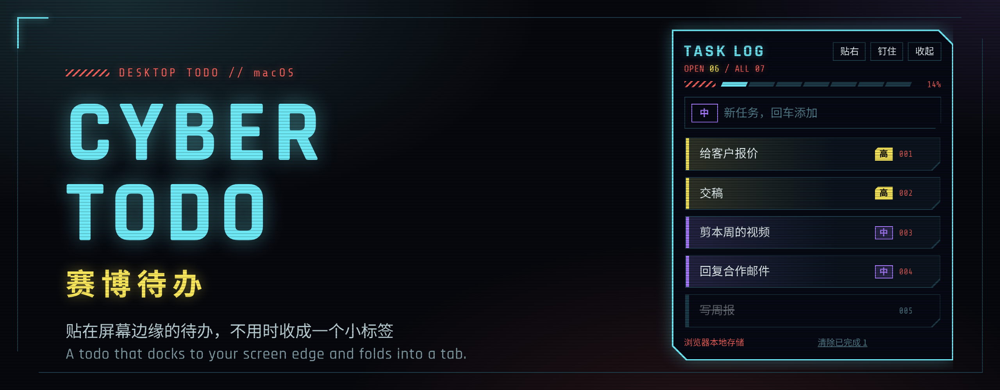
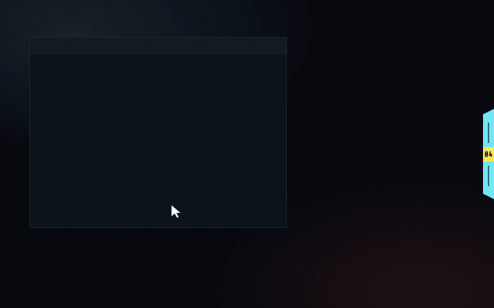
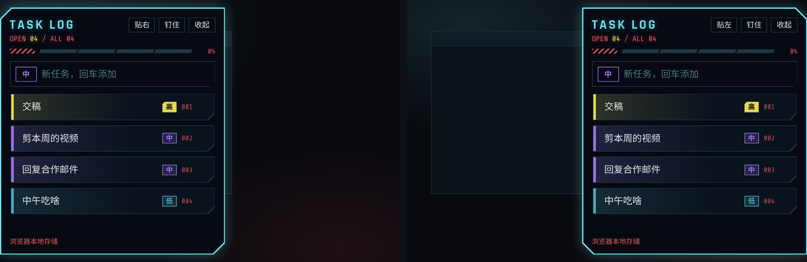

<div align="center">



<p>
  <a href="README.md">简体中文</a> &nbsp;·&nbsp; <b>English</b>
</p>

<p>
  
  
  
  
</p>

</div>

A cyberpunk-style desktop todo. It docks to the edge of your screen and folds into a small tab when you are not using it; hover the tab or press a hotkey and it slides back out. Tasks live in a plain Markdown file, so other programs and AI agents can read and write them too.

The interface text is in Chinese for now.

<p align="center">
  
</p>

## Features

| | |
| --- | --- |
| **Folds into the edge** | Only a small tab with the open-task count stays on screen, and clicks pass through the transparent area |
| **Summon from anywhere** | Press `⌥⇧T` in any app and the cursor lands in the input box |
| **Three priorities** | High, medium and low each have a colour, and the list always sorts by priority |
| **One file is the database** | `~/cyber-todo/todo.md`: edit it by hand, or let a script or agent append tasks |
| **Two dock positions** | Right or left, switched with one click |
| **Keyboard first** | Add, check, reprioritise, reorder and delete without touching the mouse |

## Quick start

Requires macOS and Node.js 22 or later.

```bash
git clone https://github.com/NOAHnorya/cyber-todo.git
cd cyber-todo
npm install
npm start
```

To package a double-clickable app:

```bash
npm run build
# creates dist/CyberTodo-darwin-<arch>/CyberTodo.app; drag it into Applications
```

The packaged app is unsigned. An app you build on your own machine opens normally.

## Controls

| Action | How |
| --- | --- |
| Show / hide | `⌥⇧T`, or move the mouse onto the tab at the screen edge |
| Hide | `Esc`, the 收起 (collapse) button, or move the mouse away for about a second |
| Keep it open | The 钉住 (pin) button |
| Add a task | Type and press Enter; start with `!` to make it high priority |
| Priority for new tasks | Click 高 / 中 / 低 (high / medium / low) left of the input box |
| Complete / reopen | Click the task, or select it and press Space |
| Change priority | Click the colour bar on the left of a task, or select it and press `1` `2` `3` |
| Reorder | Drag, or `⌥↑` `⌥↓` |
| Delete | Hover and click `×`, or select and press `Delete`; `⌘Z` undoes |
| Quit | Click the panel, then `⌘Q` |

Manual reordering only changes the order inside one priority band. Dragging a task into another band gives it that band's priority.

## Dock positions

The button in the top-right corner of the panel names the side it will move to: 贴左 (dock left) while docked right, 贴右 (dock right) while docked left. The choice is remembered.

<p align="center">
  
</p>

## Data file

Tasks are stored in `~/cyber-todo/todo.md`, one per line:

```markdown
- [ ] Ship the draft @high
- [ ] Reply to email
- [x] Write weekly report
- [ ] What's for lunch @low
```

- `- [ ]` is open, `- [x]` is done
- A trailing `@high` or `@low` sets the priority; no tag means medium
- Anything else in the file (headings, notes) is kept as it is

The app checks the file every few seconds, so you can edit it in any editor or append to it from a script, and the panel updates by itself:

```bash
echo "- [ ] Back up the footage drive @high" >> ~/cyber-todo/todo.md
```

## Project layout

| File | Purpose |
| --- | --- |
| `index.html` | The whole interface and todo logic in one file, no dependencies |
| `main.js` | Electron main process: transparent always-on-top window, click-through, global hotkey, data file access |
| `preload.js` | Hands those abilities to the page as `window.claude.use("desktop")` |
| `scripts/build.sh` | Generates the icon and packages the app |
| `scripts/selftest.js` | Self-test, run with `npm run selftest` |

`index.html` was first written as a Claude artifact against the Claude desktop app's "Install as app" interface. `preload.js` provides an object of the same shape, so the same page runs in both places. Opening `index.html` straight in a browser gives a preview mode that keeps data in the browser only.

The page can only read and write files inside `~/cyber-todo/`; the main process refuses any other path.

## Notes

This is a personal fan project. Its look borrows colours and layout conventions common to cyberpunk game interfaces. It is not affiliated with CD PROJEKT RED and uses no game assets.

## License

[MIT](LICENSE)
