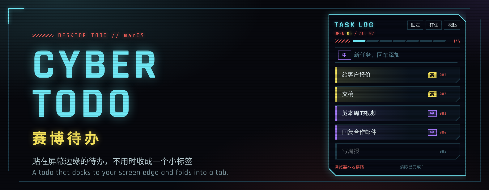
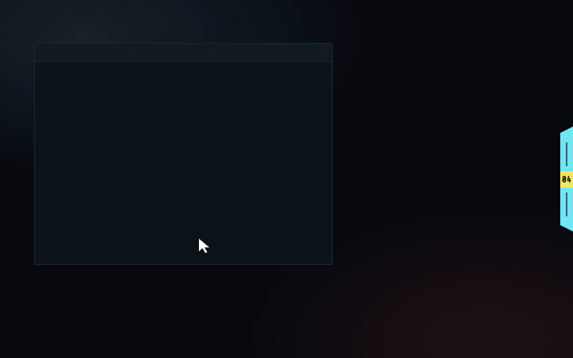
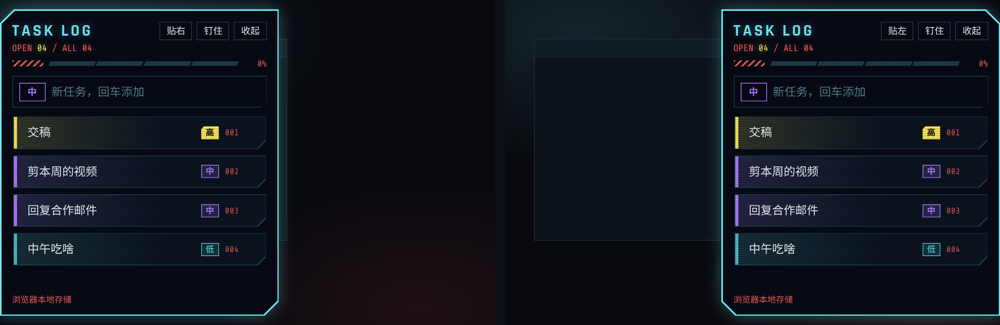

<div align="center">



<p>
  <b>简体中文</b> &nbsp;·&nbsp; <a href="README.en.md">English</a>
</p>

<p>
  
  
  
  
</p>

</div>

一个赛博朋克风格的桌面待办。它贴在屏幕边缘，不用的时候收成一个小标签，鼠标移上去或按快捷键再滑出来。任务存成一个普通的 Markdown 文件，别的程序和 AI agent 也能直接读写。

<p align="center">
  
</p>

## 特性

| | |
| --- | --- |
| **贴边收起** | 平时只在屏幕边缘留一个带未完成数的小标签，透明区域不挡鼠标 |
| **随手呼出** | 任何应用里按 `⌥⇧T`，光标直接落在输入框 |
| **三档优先级** | 高、中、低各有颜色，列表始终按优先级自动排序 |
| **数据就是一个文件** | `~/cyber-todo/todo.md`，可以手改，也可以让脚本或 agent 往里加任务 |
| **左右两个贴附位置** | 贴右或贴左，一键切换 |
| **全键盘操作** | 添加、勾选、改优先级、排序、删除都不用碰鼠标 |

## 快速开始

需要 macOS 和 Node.js 22 或更新的版本。

```bash
git clone https://github.com/NOAHnorya/cyber-todo.git
cd cyber-todo
npm install
npm start
```

打包成可以双击打开的应用：

```bash
npm run build
# 生成 dist/CyberTodo-darwin-<arch>/CyberTodo.app，拖进“应用程序”即可
```

打出来的应用没有签名，在自己电脑上构建的可以直接打开。

## 操作

| 操作 | 方式 |
| --- | --- |
| 呼出 / 收起 | `⌥⇧T`，或把鼠标移到屏幕边缘的小标签上 |
| 收起 | `Esc`、点“收起”，或鼠标移开约 1 秒 |
| 不自动收起 | 点“钉住” |
| 添加任务 | 输入后回车；开头打 `!` 直接设为高优先级 |
| 选新任务的优先级 | 点输入框左边的 高 / 中 / 低 |
| 完成 / 取消完成 | 点任务，或选中后按空格 |
| 改优先级 | 点任务左侧的色条，或选中后按 `1` `2` `3` |
| 排序 | 拖动，或 `⌥↑` `⌥↓` |
| 删除 | 悬停后点 `×`，或选中后按 `Delete`；`⌘Z` 撤销 |
| 退出 | 点一下面板后按 `⌘Q` |

手动排序只调整同一档里的先后；把任务拖进另一档，它的优先级会变成那一档。

## 贴附位置

面板右上角的按钮写的是“点了会去哪边”：贴在右边时显示“贴左”，贴在左边时显示“贴右”。选择会记住。

<p align="center">
  
</p>

## 数据文件

任务存在 `~/cyber-todo/todo.md`，一行一个：

```markdown
- [ ] 交稿 @high
- [ ] 回邮件
- [x] 写周报
- [ ] 中午吃啥 @low
```

- `- [ ]` 未完成，`- [x]` 已完成
- 行尾的 `@high` / `@low` 是优先级，不写就是中
- 文件里的其他内容（标题、笔记）会原样保留

应用每隔几秒检查一次这个文件，所以可以用任何编辑器改它，也可以让脚本往里追加一行，面板会自动更新：

```bash
echo "- [ ] 备份素材硬盘 @high" >> ~/cyber-todo/todo.md
```

## 项目结构

| 文件 | 作用 |
| --- | --- |
| `index.html` | 整个界面和待办逻辑，单文件，没有依赖 |
| `main.js` | Electron 主进程：透明置顶窗口、鼠标穿透、全局快捷键、读写数据文件 |
| `preload.js` | 把主进程的能力以 `window.claude.use("desktop")` 的形式交给页面 |
| `scripts/build.sh` | 生成图标并打包 |
| `scripts/selftest.js` | 自测，`npm run selftest` |

`index.html` 最初是作为 Claude 的工件写的，用的是 Claude 桌面端“安装为应用”的接口。`preload.js` 提供了同样形状的接口，所以同一个页面在两边都能跑。直接用浏览器打开 `index.html` 则是预览模式，数据只存在浏览器里。

页面只能读写 `~/cyber-todo/` 里的文件，其他路径会被主进程拒绝。

## 说明

这是一个粉丝向的个人项目，视觉上参考了赛博朋克类游戏界面常见的配色和版式，与 CD PROJEKT RED 没有关联，也没有使用任何游戏素材。
